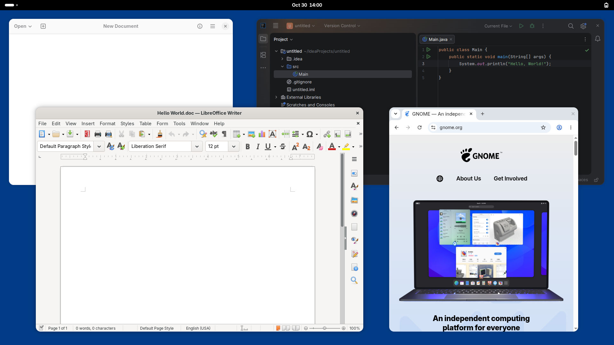

  <h1>Rounded Window Corners Native</h1>
  
<i>Rounds every window to match libadwaita, with nothing to set up.</i>

  

   

  
  
  

 

Gives GTK 3, Qt, Electron, Java and every other app the corners, outline and shadow of a
libadwaita window.

In the screenshot, Text Editor (top left) is a libadwaita app. IntelliJ IDEA (Java),
LibreOffice (GTK 3) and Chromium are rounded by this extension to match it.

## How it behaves

- **Looks like libadwaita.** The radius, outline and shadow come from libadwaita's own
  stylesheet, so light, dark and high contrast follow on their own.
- **Follows your gtk.css.** Change the window radius or outline in
  `~/.config/gtk-4.0/gtk.css` and every window follows, live. Your GTK theme is ignored,
  as libadwaita ignores it.
- **Settings only if you want them.** Choose which apps are rounded, round maximized and
  tiled windows, and give an app or a whole toolkit a style of its own. See
  [Customization](docs/customization.md).
- **Patches nothing.** No GNOME Shell method is overridden, so it doesn't get in the way
  of your dock or tiling extension.

## Recommended

The extension rounds the window; these make what's inside GTK 3 apps match libadwaita too:

- [adw-gtk3](https://github.com/lassekongo83/adw-gtk3), libadwaita's look as a GTK 3 theme.
- [Legacy (GTK3) Theme Scheme Auto Switcher](https://extensions.gnome.org/extension/4998/legacy-gtk3-theme-scheme-auto-switcher/),
  which switches GTK 3 apps between the light and dark theme with the rest of the system.

## Compared to the others

[Rounded Window Corners](https://github.com/yilozt/rounded-window-corners) and
[Reborn](https://github.com/flexagoon/rounded-window-corners) came first, and this project
learned from both.

| | This | The others |
| --- | --- | --- |
| Outline color | from libadwaita and your gtk.css, or one you pick | one you pick |
| Light, dark and high contrast | automatic | one color serves all |
| Shell methods patched | none | three, for the overview and workspace switching |
| Per window | two effects | an effect, plus a shadow actor with its own effect and four constraints |

Use theirs if you want squircles. Use this one if you'd rather it match the rest of GNOME
and never think about it.

## Docs

- [Customization](docs/customization.md): the settings, and which style a window gets
- [How it works](docs/how-it-works.md): how windows are drawn, and the limits
- [Development](docs/development.md): running, testing and translating

## License

GPL-3.0-or-later.

Some parts are adapted from LGPL-2.1-or-later projects:

- the shadow, from GTK's renderer (`gsk/gpu/shaders/gskgpuboxshadow.glsl`)
- the color conversions, from GTK (`gtk/gtkcolorutils.c`, `gdk/gdkhsla.c`)
- the color functions and `color-mix()`, from GTK (`gtk/gtkcsscolorvalue.c`, `gtk/gtkcsscolor.c`)
- the built-in window style, from libadwaita's stylesheet
