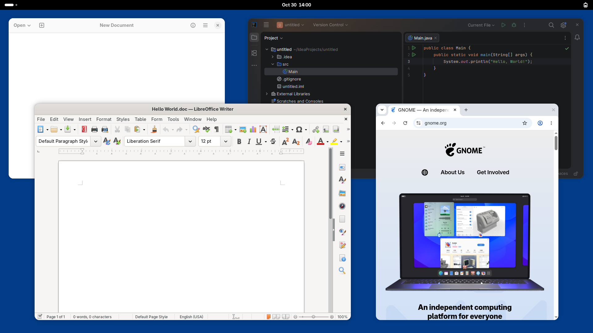
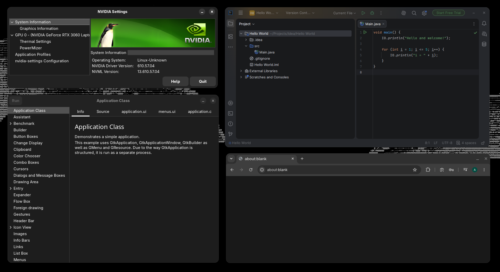

# Rounded Window Corners Native

Rounds every window to match libadwaita. Nothing to configure.

GNOME only rounds apps built with libadwaita. GTK3, Qt, Electron, Java and most terminals
stay square. This extension gives them the same corners, hairline outline and shadow that
libadwaita draws, so every window looks like it belongs.

In the shots above, NVIDIA Settings and the GTK3 demo are GTK3, IntelliJ IDEA is Java and
draws its own window decorations, and Chromium is bottom right. All four are rounded by
this extension.

Requires GNOME Shell 51.

## How it behaves

**Like libadwaita.** The radius, outline and shadow come from libadwaita's own stylesheet,
so light, dark and high contrast follow on their own.

**Your gtk.css counts.** Change the window radius or outline in
`~/.config/gtk-4.0/gtk.css` and the other windows follow your libadwaita apps, live. Your
GTK theme is ignored, because libadwaita ignores it too.

**Patches nothing.** No GNOME Shell method is overridden, so there is nothing to fight
with your dock or tiling extension.

## Recommended themes

[adw-gtk3](https://github.com/lassekongo83/adw-gtk3) for GTK3 apps, or
[Monolith](https://github.com/ztrahmet/gnome-theme-monolith), a monochrome GTK and shell
theme that includes adw-gtk3.

## Compared to the others

[Rounded Window Corners](https://github.com/yilozt/rounded-window-corners) and
[Reborn](https://github.com/flexagoon/rounded-window-corners) came first, and this project
learned from both.

| | This | The others |
| --- | --- | --- |
| Border colour | from libadwaita and your gtk.css | you pick it |
| Light / dark / contrast | automatic | one colour serves both |
| Shell methods patched | none | three |
| Actors per window | one effect | effect, shadow widget, constraints |

Use theirs if you want squircles or different corners for one app. Use this one if you
would rather it match the rest of GNOME and never think about it.

## Docs

- [How it works](docs/how-it-works.md)
- [Development](docs/development.md)

GPL-3.0-or-later.
