# Customization

The extension needs no setup, and everything on this page is optional.

> [!TIP]
> To change how windows look, prefer `gtk.css` to a custom style. Your apps read it too, so
> libadwaita windows, GTK 3 windows and the windows this extension rounds all keep the same
> corners. For example, a radius of 8 px:
>
> ```css
> /* ~/.config/gtk-4.0/gtk.css: libadwaita apps, and this extension */
> window.csd { --window-radius: 8px; }
> window.csd.tiled, window.csd.tiled-top, window.csd.tiled-right, window.csd.tiled-bottom,
> window.csd.tiled-left, window.csd.maximized, window.csd.fullscreen { --window-radius: 0px; }
> ```
>
> ```css
> /* ~/.config/gtk-3.0/gtk.css: GTK 3 apps */
> decoration, .titlebar { border-radius: 8px 8px 0 0; }
> .tiled decoration, .tiled-top decoration, .tiled-right decoration, .tiled-bottom decoration,
> .tiled-left decoration, .maximized decoration, .fullscreen decoration,
> .tiled .titlebar, .tiled-top .titlebar, .tiled-right .titlebar, .tiled-bottom .titlebar,
> .tiled-left .titlebar, .maximized .titlebar, .fullscreen .titlebar { border-radius: 0; }
> ```
>
> The second rule in each keeps tiled, maximized and fullscreen windows square, which
> `gtk.css` would otherwise round too. To keep libadwaita windows rounded when tiled or
> maximized, leave only `window.csd.fullscreen` in it. libadwaita then rounds them itself,
> without turning on **Round libadwaita Apps**.
>
> A custom general style replaces `gtk.css` for the extension.

Open the settings from the Extensions app, or with:

```bash
gnome-extensions prefs rounded-window-corners@ztrahmet.github.io
```

<div align="center">

| General | App Styles | A toolkit's style |
| :---: | :---: | :---: |
| 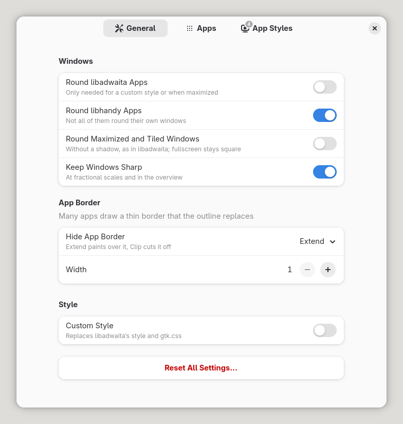 | 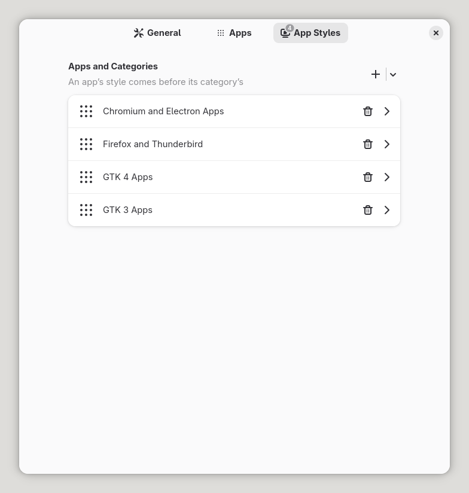 | 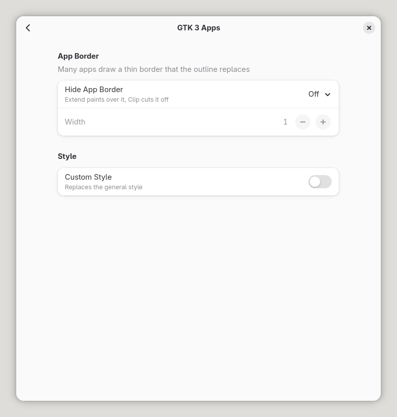 |

</div>

- **General**: which kinds of windows are rounded, and the general style.
- **Apps**: the apps and toolkits that are never rounded, or the only ones that are.
- **App Styles**: apps and toolkits with a style of their own.

**Reset All Settings…** at the bottom of the General tab brings everything back to how it
was installed.

## Which windows are rounded

Out of the box, every normal window and dialog is rounded, except those of libadwaita
apps, which round themselves.

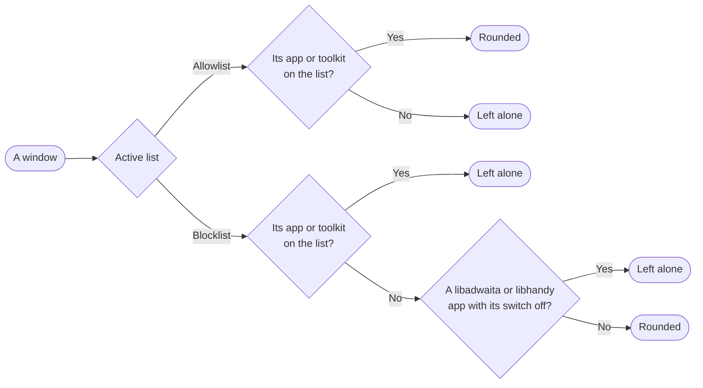

- **Round libadwaita Apps** and **Round libhandy Apps**, on the General tab, are the
  switches. libhandy apps are rounded by default, since not all of them round their own
  windows.
- The **Apps** tab holds the blocklist and the allowlist. Switching the active list keeps
  both.
- **Round Maximized and Tiled Windows** keeps those windows rounded, with the look
  libadwaita gives them: no shadow when maximized, and a thin line around a tiled window.
  Fullscreen windows always stay square.
- **Keep Windows Sharp**, on by default, draws rounded windows at the scale they're shown
  at, so they stay sharp at fractional scales and in the overview. It works around a blur
  in mutter. If a window looks wrong or something runs slowly, turn it off to see whether
  it's the cause.

Apps are matched the way GNOME Shell matches them, by their desktop file, but a dialog
that another app opens over a window, like the file chooser, counts as that other app's.
Toolkits are recognized by the libraries an app has loaded: libadwaita, libhandy, Chromium
and Electron, Firefox and Thunderbird, Java, Qt, GTK 4 and GTK 3.

## Which style a window gets

A window takes its look from the first of these whose **Custom Style** is on:

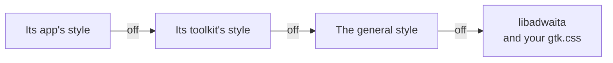

So with none of them on, a window looks like a libadwaita window, following your
`gtk.css`, light and dark, and high contrast. Styles only decide the look: a libadwaita or
libhandy app with a style of its own still needs its switch on, or a place on the
allowlist, to be rounded.

For example, say **GTK 3 Apps** has its custom style on, and you add a GTK 3 app with its
own switch left off. That app keeps the GTK 3 style, but can still hide its border its own
way.

### Custom styles

A custom style sets the **corner radius**, the **outline**'s width, color, opacity and
position, and the **shadow**: libadwaita's shadow, moved by the light angle and distance,
with your blur, color and opacity. It looks the same in light, dark and high contrast.
Maximized and tiled windows keep libadwaita's look for those states, with the shadow's
color for the line around a tiled window. The general custom style also stops `gtk.css`
from counting.

<div align="center">

| Inside | Center | Outside |
| :---: | :---: | :---: |
| 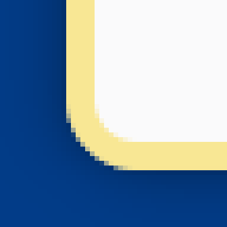 | 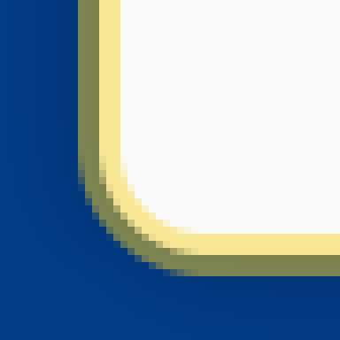 | 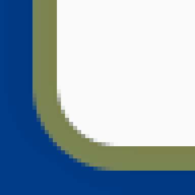 |
| As libadwaita draws it | Across the edge | Outside the edge |

</div>

## Hiding the app's border

Many apps draw a thin border of their own, just inside the window's edge. Once the corners
are rounded, it ends in the middle of the curve. **Hide App Border** chooses what happens
to it. Here, the app draws a red 1 px border:

<div align="center">

| Without the extension | Off | Extend | Clip |
| :---: | :---: | :---: | :---: |
| 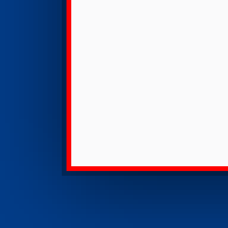 | 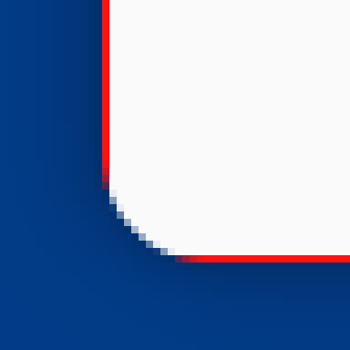 | 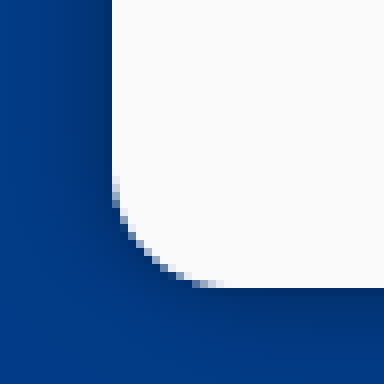 |  |
| Square, as the app draws it | The border stays | Painted over with the color just inside it | Cut off, so the window's edge moves in |

</div>

**Width** sets how wide the app's border is, for Extend and Clip. App and toolkit styles
also offer **Inherit**, which does what the toolkit's style does, or else the general one.

Each style sets this whether its custom switch is on or off. App and toolkit styles start
on Inherit, except the four toolkits listed out of the box, Chromium and Electron, Firefox,
GTK 4 and GTK 3. Those start on Off: they draw little or no border, and painting over one
would stretch their content at the edges.
