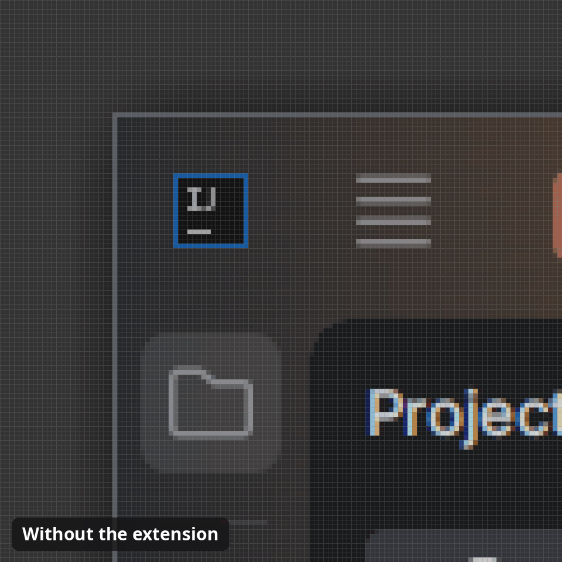

# How it works

Each rounded window gets one shader effect, and a small helper effect that makes room for
its shadow. Nothing in GNOME Shell is patched or replaced.

With **Keep Windows Sharp** turned on, a second shader effect draws the window instead,
at the scale it's shown at.

## Drawing a window

The shader draws each window in four steps:

  

1. **Fill.** The app's own thin border, if it draws one, is hidden.
   [Customization](customization.md#hiding-the-apps-border) shows the ways to do it.
2. **Clip.** The window is cut to its rounded shape.
3. **Shadow.** The shadow is drawn outside it.
4. **Outline.** The outline is drawn on top, in the same order GTK draws it.

The shadow is computed the way GTK's renderer computes libadwaita's, and always at its full
size, even for apps that leave no room around their window. Edges are drawn at the
screen's pixel density, so they stay as crisp as libadwaita's at any scale.

The outline and shadow belong to the window itself, so the overview and the window
switcher show them too. On X11 apps, mutter's title bar is rounded with the rest of the
window, and mutter's own shadow is replaced.

## Where the look comes from

The extension works out the window's look as GTK would for a libadwaita window:
libadwaita's stylesheet first, then your accent color, then your
`~/.config/gtk-4.0/gtk.css`. Light, dark and high contrast follow the system, and tiled
and maximized windows get the rules libadwaita has for them. Mutter doesn't say which
edge a window is tiled at, so a tiled window counts as tiled at every edge.

Edits to `gtk.css`, and to the files it imports, apply as soon as they are saved.

GNOME Shell can't load libadwaita itself, so a small helper process reads its stylesheet.
If that ever fails, a built-in copy of libadwaita's window rules is used instead.

A [custom style](customization.md#which-style-a-window-gets) replaces all of this with
values from the settings.

## Maximized, tiled and fullscreen

By default, maximized, tiled and fullscreen windows are left square, as libadwaita leaves
its own. As in libadwaita, a window's look changes once the app has drawn its new size,
not the moment its state changes, so there is no flash of the wrong corners.

At a radius of 0, a window keeps its outline and shadow, as libadwaita's do.

## Limits

- An app that draws larger corners than the radius keeps its own corners. For GTK apps,
  give them the same radius in `gtk.css`, as the tip in [Customization](customization.md)
  shows.
- Toolkits are recognized by the libraries an app has loaded, which Linux hides for apps
  that guard their memory. Their windows are still rounded, but toolkit lists and styles
  don't apply to them.
- Mutter slightly blurs windows drawn through an effect, in the overview
  ([#2](https://github.com/ztrahmet/rounded-window-corners/issues/2)) and at fractional
  scales ([#20](https://github.com/ztrahmet/rounded-window-corners/issues/20)). Both are
  tracked upstream. Until they're fixed, turning on **Keep Windows Sharp** works around
  them.

## Performance

A rounded window is drawn through a buffer the size of the window and its shadow. On a
GPU this takes a fraction of a millisecond per frame, even for a window that repaints
all the time, so apps stay as smooth as without the extension.

Maximized and fullscreen windows cost nothing extra while they are left square.

## Turning it off

Everything the extension sets up is removed when it's turned off. GNOME turns extensions
off while the screen is locked, so everything is set up again after unlocking.
